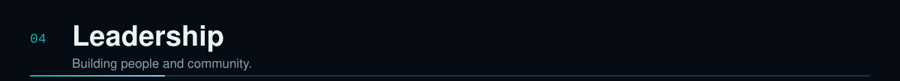

  
  
  

I'm a Computer Science student at **KITS Guntur** and an AI engineer. I design and build **RAG architectures**, **agentic AI pipelines** and **LLM fine-tuning** workflows, then wrap them in production-grade full-stack products: Django and Next.js on top, AWS and Terraform underneath, pgvector for retrieval.

I care about cost-conscious infrastructure, clear documentation and software that can explain how it works.

<!-- Add repository / live-demo badges under each card once the repos are public, e.g.:

  

-->

**President, Innovation Club — KITS Guntur.** Building the club's structure, events and a multi-page Next.js club website.

  

<!-- Optional contribution snake: add .github/workflows/snake.yml (included), run it once, then uncomment:

-->

  
  
  

