  
  
  

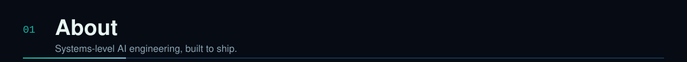
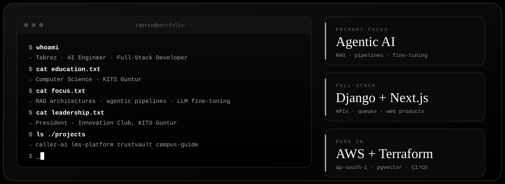

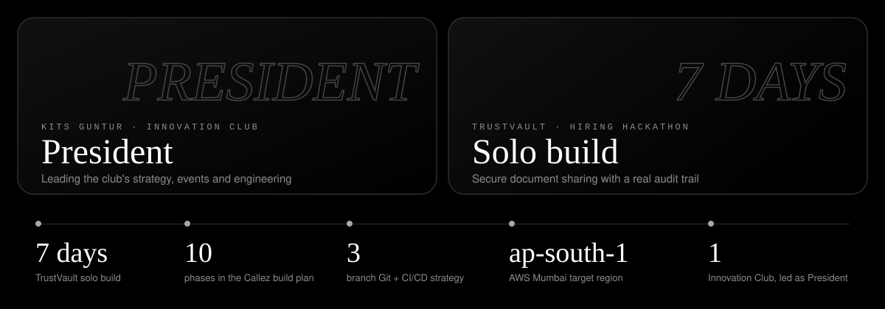


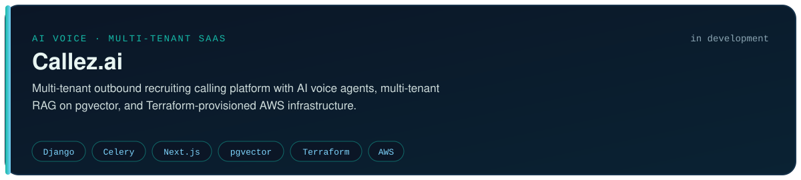




<!-- Once a repo or demo is public, add a badge row directly under its card:

  
  

-->

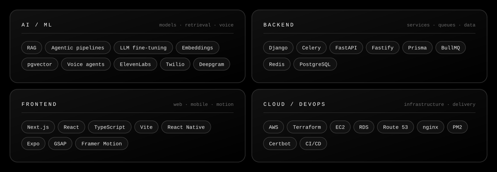


  

<!-- Optional contribution snake: the workflow in .github/workflows/snake.yml writes it to an "output" branch.
Run the workflow once from the Actions tab, then uncomment:

-->

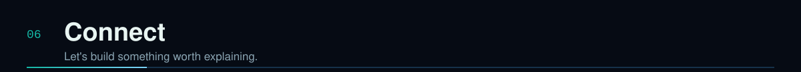

  
  
  

